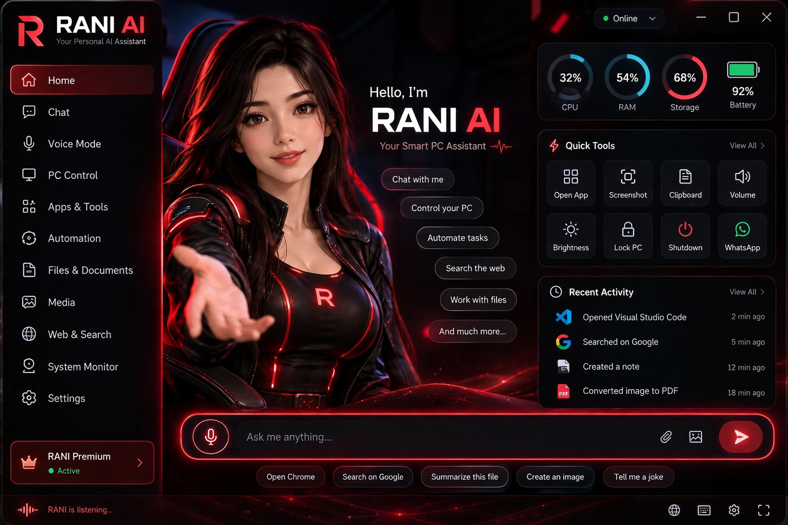

<div align="center">


# RANI AI

**Your personal AI assistant: voice, vision and an AI website builder — on your phone.**
*Speak to RANI, she listens, acts, and can even build and deploy a website for you.*

[](LICENSE)


</div>

> **Platform: Android only.** No Windows build and no iOS build — see [`docs/ANDROID.md`](docs/ANDROID.md). The desktop Python source kept in this repo (`RANI_AI_APP/`, `rani-linux/`, `rani-termux/`) is reference material only and is not the target platform.

---

## Screenshots

<div align="center">



*Main window: navigation, live system stats, quick tools, recent activity and the "Ask me anything" voice/chat bar.*

</div>

## Features

| Area | What RANI can do |
|---|---|
| **Voice** | Hands-free conversation through Gemini Live in 148+ languages (Hindi, Hinglish, English and more) |
| **Chat** | Text chat with attachments and images |
| **Vision** | Camera vision and screen sharing, so RANI can see what you see |
| **Files and documents** | Work with PDF, Word, Excel and PowerPoint files, QR codes, OCR |
| **Web and media** | Google/YouTube search, Spotify control, WhatsApp messages, downloads |
| **System monitor** | Live CPU, RAM, storage and battery |
| **Floating orb and glow** | Always-on-top mini assistant and edge-glow listening indicator |
| **RANI Coder** | AI website builder: say *"gaming website banao dark theme ke saath"* and RANI builds it, then deploys it to GitHub/Vercel |
| **Face authentication** | Optional face unlock |

## Repository layout

```
RANI-AI-ASSISTANT/
├── rani-web/             # THE APP — phone web app (voice, chat, vision, builder, PWA)
│   ├── index.html        # main UI (settings, voices and interface as in the original)
│   ├── app.js            # Gemini Live voice, chat, tools
│   └── admin.html        # login-gated admin panel shell
├── android/              # Android WebView wrapper (package com.badshah222.rani.ai)
│   └── app/src/main/     # MainActivity, manifest, offline page
├── .github/workflows/    # android-build.yml — CI builds the APK (debug always, signed release with secrets)
├── RANI_AI_APP/          # Original desktop source (PyQt5) — reference only, not the target
│   ├── aria.py           # main window / entry point
│   ├── aria_modules/     # face auth, activation, cloud DB, tools, assets
│   ├── rani_coder/       # Node.js + TypeScript AI coding agent
│   ├── website_builder/  # Python "WebForge" website pipeline + deploy
│   ├── rani/             # pip-installable CLI (rani, rani-reset, rani-upgrade)
│   ├── backend/          # FastAPI licensing server (server-side only)
│   └── admin_and_build_tools/  # developer-only tooling (keygen, EXE build)
├── rani-linux/           # Linux desktop source — reference only
├── rani-termux/          # Android (Termux) and Linux CLI/web UI — reference only
└── docs/                 # ANDROID.md (how the APK builds), AUTH-SETUP.md (Supabase + Firebase)
```

## Quick start — Android only

### 1. Run the web app

```bash
cd rani-web
cp js/config.example.js js/config.js   # paste YOUR Gemini / Supabase / Firebase keys (never commit config.js)
python3 -m http.server 8080
# open http://localhost:8080
```

A free Gemini API key: <https://aistudio.google.com/apikey>. Without a key the app runs in demo mode and says so. Auth and database setup (Supabase + Firebase, same system as BADSHAH AI) is in [`docs/AUTH-SETUP.md`](docs/AUTH-SETUP.md) — no live keys are in this repo.

### 2. Get the Android APK (CI)

Push to `main` (or open a PR) touching `android/`, `rani-web/`, or the workflow file. GitHub Actions builds a **debug APK** on every run — download it from the run's Artifacts (`rani-ai-debug-apk`). A **signed release APK** is built only when the four signing secrets exist in the repo (Settings → Secrets and variables → Actions): `ANDROID_KEYSTORE_BASE64`, `KEYSTORE_PASSWORD`, `KEY_ALIAS`, `KEY_PASSWORD`. No keystore is committed to this repo. Full details: [`docs/ANDROID.md`](docs/ANDROID.md).

> The workflow file (`.github/workflows/android-build.yml`) cannot be pushed with the GitHub connector (403) — push it via the browser (github.com web upload) or git from a machine with repo access.

### 3. Try it

- *"Open Chrome"* / *"Search on Google"*
- *"Summarize this file"*
- *"Portfolio website bana mere liye"*
- *"Restaurant ka website create karo"*

The RANI Coder panel opens automatically when you ask for a website.

## How the website builder works

```
Voice command
   ↓  Gemini Live speech recognition
_is_website_command() check
   ↓
RANI Coder panel opens in the UI
   ↓
node dist/run.js --progress-file tmp.jsonl
   ↓
AI agent → tools → project files are created
   ↓  live JSON progress → Qt signals → UI updates
Done → deploy to GitHub / Vercel (WebForge)
```

`rani_coder/` is a provider-agnostic agent (Gemini, Anthropic, Ollama, OpenRouter, NVIDIA).

## Licensing / activation

RANI licensing runs **locally by default — no remote server, no phone-home**. The `backend/` FastAPI licensing server is optional, server-side only, and is never shipped to clients. Point it at your own Firebase project (`docs/AUTH-SETUP.md`).

## Troubleshooting

| Problem | Fix |
|---|---|
| `RANI Coder build not found` | `cd rani_coder && npm install && npm run build` |
| API key error | Check `GEMINI_API_KEY` in your local config (no quotes or spaces) |
| No voice or mic input | Check the browser / phone microphone permission and the default input device |
| APK not building in CI | See `docs/ANDROID.md` — the workflow needs no secrets for a debug APK |

## Contributing

Issues and pull requests are welcome.

1. Fork the repo and create a branch: `git checkout -b feature/my-change`
2. Match the surrounding code style (Python files mix English identifiers with Hinglish comments, which is fine)
3. Open a pull request describing the change

**Never commit secrets.** `.env`, API keys and tokens must stay out of git.

## Security

If you find a vulnerability, please open a private security advisory on GitHub instead of a public issue. If you ever accidentally publish a key, revoke it immediately.

## License

Released under the [MIT License](LICENSE). RANI Coder is based on HunterCode (MIT). Third-party notices: [`THIRD-PARTY-NOTICES.md`](THIRD-PARTY-NOTICES.md).

---

<div align="center">Made with ❤️ by <a href="https://github.com/Badshah-official512">Zain Shah</a></div>
